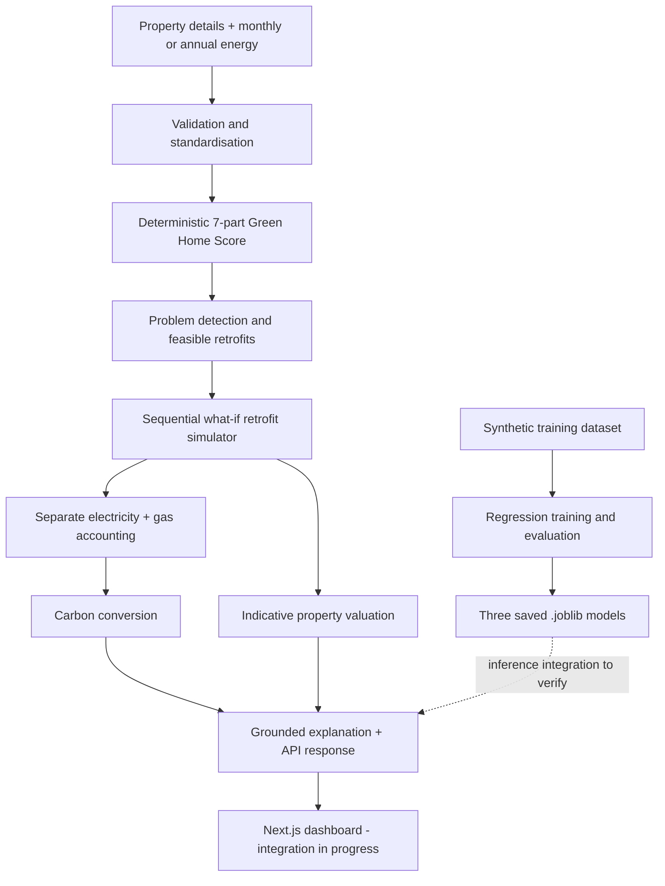

# Green Home Twin — Green Home Score & Retrofit Engine

**Megathon X: Singularity | Lloyds Problem Statement 2**

Green Home Twin is a UK residential sustainability prototype that calculates a transparent **Green Home Score (0–100)**, detects areas of energy inefficiency, recommends feasible retrofits, and models the effects of selected upgrades on **electricity, gas, carbon emissions and indicative property value**.

> **Current status:** The backend, deterministic scoring logic, retrofit simulation and three trained ML models have been implemented. The Next.js frontend is still a starter interface. Further end-to-end integration and real-world validation are in progress.

## Core features

- **Explainable Green Home Score:** Seven fixed-weight sub-scores, with individual contributions and an efficiency classification.
- **Property diagnostics:** Find poor energy performance, inefficient heating, poor insulation and outdated glazing.
- **Retrofit recommendations:** Evaluate loft/roof insulation, double glazing, air-source heat pumps, solar PV and smart thermostats subject to feasibility checks.
- **What-if simulation:** Recalculate the entire chosen retrofit package, accounting for interactions between upgrades rather than simply adding standalone savings.
- **Fuel-specific energy and carbon estimates:** Show electricity and gas changes separately, including the electricity increase that can result from installing a heat pump.
- **Indicative property value range:** Model possible price implications, explicitly *not* guaranteed or causally established uplift.
- **Grounded explanations:** Optional Gemini integration explains already-calculated figures, with a fallback when no API key is configured.
- **Regression-model experiments:** Predict annual electricity use, annual gas use and historical sale price with trained scikit-learn pipelines.

## System architecture



**Implementation note:** `backend/app/api/v1/routes.py` currently calls the service layer in `backend/app/services/`. The trained models are loaded by a separate module, `backend/src/inference.py`. Before demonstrating fully ML-backed API predictions, verify that each public API path invokes the intended trained model.

## Green Home Score methodology

This is a **deterministic weighted score**, not a model trained to predict a score:

```text
Score = round(sum(component_score × component_weight))
```

| Scoring component | Weight |
| --- | ---: |
| Energy efficiency / EPC band | 25% |
| Annual energy intensity (kWh/m²/year) | 20% |
| Insulation | 15% |
| Heating system | 15% |
| Windows and glazing | 10% |
| Renewable energy | 10% |
| Smart energy controls | 5% |
| **Total** | **100%** |

Efficiency bands: **Highly efficient (80–100)**, **Good (65–79)**, **Moderate (50–64)**, **Poor (30–49)**, **Very poor (0–29)**.

## ML experiments and evaluation

The training pipeline compared **Median Dummy baseline**, **Ridge Regression**, **Random Forest** and **HistGradientBoosting**. HistGradientBoosting was selected for the three prediction targets.

| Held-out synthetic test target | MAE | RMSE | R² | WAPE |
| --- | ---: | ---: | ---: | ---: |
| Annual electricity (kWh) | 323.47 | 596.91 | 0.9825 | 6.21% |
| Annual gas (kWh) | 893.69 | 1,377.22 | 0.9792 | 6.43% |
| Historical sale price (GBP) | £17,130.99 | £25,266.31 | 0.9779 | 5.58% |

**Data:** 5,000 **synthetically generated** UK residential properties, split by customer into **3,509 training**, **753 validation** and **738 held-out test** records. The dataset also includes monthly synthetic energy observations and synthetic sale histories. Its generation was calibrated using published UK housing, energy and sales benchmarks, but the underlying individual property records are not actual UK household measurements.

**Interpretation:** Strong metrics on held-out synthetic data do **not** establish equivalent performance on real UK housing stock. Property-value relationships are observational/model-based and should not be interpreted as a guaranteed causal uplift.

Full metrics and validation methodology: [backend/reports/evaluation.md](backend/reports/evaluation.md).

## Run the project locally

### Backend — FastAPI

```bash
git clone https://github.com/goyaladitay11/megathon.git
cd megathon/backend

python3 -m venv .venv
source .venv/bin/activate
pip install -r requirements.txt
cp .env.example .env

python -m uvicorn main:app --reload --port 8000
```

- Swagger / interactive API: http://127.0.0.1:8000/docs
- Health check: http://127.0.0.1:8000/health

The `.env.example` template contains optional `GEMINI_API_KEY` and Supabase credentials. **Never commit real `.env` files, API keys or service-role credentials.**

### Frontend — Next.js and Tailwind

In a separate terminal from the repository root:

```bash
cd frontend
npm install
cp .env.example .env.local
npm run dev
```

Open http://localhost:3000. `NEXT_PUBLIC_API_URL` is set in `frontend/.env.local` and defaults to `http://localhost:8000`. **The current frontend still shows the hackathon starter/health-check view; the full Green Home dashboard is not finished.**

### Run tests and model training

From `backend/`, with the virtual environment activated:

```bash
python src/data_validation.py
python -m pytest tests/ -v
python src/train_models.py
```

**Recorded M2 test result:** 21 tests passed. This is a historical test run, not a live CI guarantee. Model training need not be repeated every time you start the API.

The saved trained models are:

```text
backend/models/
├── energy_electricity.joblib
├── energy_gas.joblib
└── property_value.joblib
```

## API endpoints

| Method | Endpoint | Purpose |
| --- | --- | --- |
| GET | `/health` | API service status |
| GET | `/api/v1/properties` | Example property inputs |
| GET | `/api/v1/properties/{property_id}` | Example property by ID |
| GET | `/api/v1/catalogue` | Retrofit options |
| POST | `/api/v1/analyze` | Green Home Score, diagnostics and recommendations |
| POST | `/api/v1/simulate` | Selected package what-if simulation |
| POST | `/api/v1/chat` | Natural-language what-if explanation |
| GET | `/api/v1/customer-memory/{customer_id}` | Customer memory and preferences |
| GET | `/api/v1/metrics` | API evaluation/status payload |

> **Metrics endpoint caveat:** The current `/api/v1/metrics` endpoint may return a fallback payload instead of the ML training report. The authoritative saved ML metrics are in `backend/reports/evaluation.md`.

### Example property analysis

With the backend running:

```bash
curl -sS -X POST http://127.0.0.1:8000/api/v1/analyze \
  -H 'Content-Type: application/json' \
  -d '{
    "property_id": "DEMO001",
    "customer_id": "C0001",
    "property_type": "semi_detached",
    "age": 1975,
    "floor_area_m2": 95,
    "region": "South East",
    "bedrooms": 3,
    "energy_rating": "E",
    "insulation": "poor",
    "heating": "gas_boiler",
    "glazing": "single",
    "solar": "none",
    "smart_controls": false,
    "current_property_value_gbp": 325000,
    "annual_electricity_kwh": 4800,
    "annual_gas_kwh": 12000
  }'
```

In the public API, `age` represents the **construction year**. You can supply annual metered energy or monthly observations. See `/docs` for the exact schema.

### Example what-if simulation

```bash
curl -sS -X POST http://127.0.0.1:8000/api/v1/simulate \
  -H 'Content-Type: application/json' \
  -d '{
    "property_id": "P10001",
    "selected_retrofit_ids": ["roof_insulation", "solar_pv"]
  }'
```

## Repository layout

```text
megathon/
├── backend/
│   ├── app/             # FastAPI routes, schemas, service layer
│   ├── src/             # Training, scoring, simulation, model inference
│   ├── data/            # Synthetic and processed datasets, factors
│   ├── models/          # Saved .joblib pipelines and metadata
│   ├── reports/         # Evaluation, provenance and methodology
│   ├── tests/           # Automated checks
│   ├── main.py
│   └── requirements.txt
├── frontend/
│   ├── app/             # Next.js App Router
│   ├── components/
│   ├── lib/
│   └── package.json
└── README.md
```

## Scientific and responsible-AI limitations

- The Green Home Score is based on the documented fixed-weight calculation.
- Retrofit package savings account for interactions and may differ from the sum of standalone upgrades.
- Grid electricity and natural gas are accounted for separately. Heat-pump installation can increase electricity use and reduce gas.
- Carbon results use documented UK Government 2024 reference factors: **0.20707 kg CO₂e/kWh** (electricity), **0.18254 kg CO₂e/kWh** (natural gas).
- Estimated changes in property value are **indicative**, not a guaranteed causal impact.
- An LLM can explain the calculated outputs but must not invent scores, savings or price changes.

## Next steps

1. Complete and audit API integration with the three saved ML pipelines.
2. Build the actual Green Home score and interactive retrofit dashboard in Next.js.
3. Align the `/api/v1/metrics` route with the current evaluation report.
4. Expand API and simulation tests for missing/conflicting inputs and interacting retrofits.
5. Evaluate LLM groundedness and add real-world validation where appropriate data is available.

---

*Megathon X: Singularity hackathon prototype for Lloyds PS2. Not an official Lloyds product, certified energy assessment or formal property valuation.*
